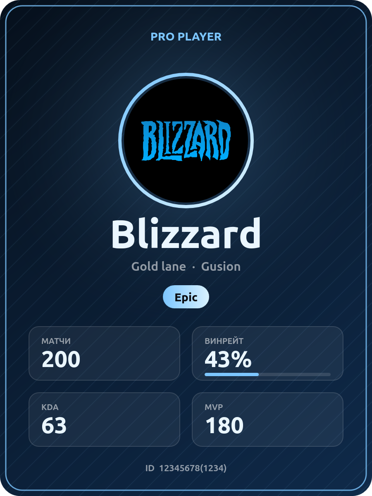

<div align="center">

# 🎮 Player Card Generator

**Ник, статистика, фото — и готовая карточка киберспортсмена за пару секунд.**

[](https://rus1amturdaliev.github.io/player-card-generator/)




</div>

---

## ✨ Что умеет

- Карточка перерисовывается сразу, пока вводишь данные
- Три стиля: **Neon**, **Gold**, **Ice**
- Поля: ник, титул, команда, роль, герой, ранг, матчи, винрейт, KDA, MVP, ID и сервер
- Шкала винрейта на карточке
- Своё фото в круглой рамке (необязательно)
- Скачивание готовой карточки в **PNG** одной кнопкой

## 🚀 Как пользоваться

1. Открой [генератор](https://rus1amturdaliev.github.io/player-card-generator/).
2. Выбери стиль и заполни поля.
3. При желании добавь фото.
4. Нажми **«Скачать PNG»** и используй карточку в профиле, чате или соцсетях.

## 🔒 Приватность

Всё работает прямо в браузере. Фото и данные никуда не отправляются и нигде не хранятся.

## 🛠 Как устроено

Один файл `index.html`: разметка, стили и скрипт, который рисует карточку на `<canvas>`. Без библиотек, сборки и серверов. Нужен современный браузер (используется `CanvasRenderingContext2D.roundRect`).

## 💻 Запуск локально

```bash
git clone https://github.com/rus1amturdaliev/player-card-generator.git
cd player-card-generator
xdg-open index.html
```

## 🎨 Свои стили

В `index.html` в объекте `S` у каждого стиля есть цвета: `a` и `b` (акценты), `bg` (фон), `t` (текст). Добавь новый стиль и кнопку с `data-s="название"`:

```js
const S = {
  // ...
  fire: { a: '#ff6b35', b: '#ffd23f', bg: ['#0d0504', '#2a0e08'], t: '#fff1e6' },
};
```

```html
<button data-s="fire">Fire</button>
```

## 🗺 Идеи на будущее

- Переключатель языка (русский и английский)
- Размеры под Telegram и Instagram
- Больше полей и стилей
- Ссылка, по которой карточка открывается с уже заполненными данными

## 👤 Автор

**Rustam Turdaliev** (ник **Blizzard**): профессиональный киберспортсмен и разработчик.

[GitHub](https://github.com/rus1amturdaliev)
